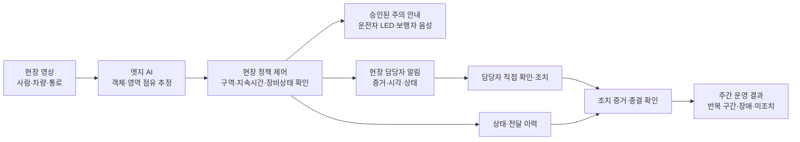

# 천안시 제안용 SLT AI 현장안전·대응 서비스 기획안

작성 기준: 2026년 10월 29일 / 제안 주체: (주)에스엘티 / 상태: 검토·협의용 초안

**추천: 에스엘티의 CCTV·전광판 설치 역량에 현장 특화 AI와 조치 이력 관리를 결합한다. 첫 사업은 공공사업 공사장 출입구·임시 보행로의 안전 안내로 한정하고, 검증 후 다른 생활 현장으로 확장한다.**

이는 현재 판매·검증된 에스엘티 고유 제품이 있다는 판단이 아니라, 사용자 제공 AI 역량과 협력 제조사를 바탕으로 만들 수 있는 통합 상품의 기획이다. 세연테크는 협력 후보이며 납품·개발·독점 계약은 확인되지 않았다. 기존 26쪽 공사현장 제안서와 원본 입력은 수정하지 않았다.

이 문서의 A부는 천안시 사전 협의용 제안 문안이다. B부는 에스엘티·AI 공급자 사이의 내부 검토 내용이므로 대외 제출 시 분리한다. 금액·성능·현장·업무 분장은 확정 사항과 제안을 구분했다.

---

## A. 천안시 사전 협의용 제안 문안

### 1. 사업명과 제안 취지

**천안시 공공사업 현장의 AI 안전안내 및 대응 이력 실증사업**

부제: 공사장 출입구와 임시 보행로에서 위험을 알아보고, 현장에 알리고, 조치 여부를 확인하는 서비스

천안시의 AI 도시 전환을 시민이 현장에서 체감할 수 있는 서비스로 연결하고자 한다. 공사 차량과 보행자가 만나는 출입구, 자재·주정차 차량으로 통행이 방해받을 수 있는 임시 보행로를 대상으로 현장 특화 영상 AI를 적용한다. 감지 결과는 운전자와 보행자에게 맞는 전광판·음성 안내로 전달하고, 현장 담당자의 확인과 후속 조치를 기록한다.

기존 CCTV·관제 인프라와의 연계를 우선 검토한다. 설치 환경과 영상 품질이 적합한 장비는 활용하고, AI 추론이나 시야 확보에 필요한 지점만 교체·보완한다. 물리적 보행 동선 분리, 시야 확보, 신호수 통제와 직접 확인을 기본 안전수단으로 유지한다.

### 2. 지금 제안하는 이유

천안·아산은 2026년 6월 AI 특화 시범도시 사업에 공동 선정됐다. 정부 발표는 천안아산역 일대를 우선지구로 하고 도시 AI 서비스 개발·실증을 추진하는 방향을 제시했다. 이는 현장 AI 서비스와의 정책적 접점을 뜻하며, 본 제안의 구매 수요나 예산을 보장하지 않는다. [국토교통부 정책브리핑, 2026.06.19](https://www.korea.kr/news/policyNewsView.do?newsId=148966818)

2026년 10월 19일 천안시의회 본회의에서는 AI 혁신기술 실증지원 사업 공공위탁 동의안이 가결됐다. 사업 참여 조건과 모집 일정은 별도 확인이 필요하다. 이번에는 도시 전체 플랫폼 구축을 제안하기보다, 현장에서 검증할 수 있는 작은 서비스 단위를 제안한다. [천안시의회 제293회 제2차 본회의](https://cheonancouncil.go.kr/cms/mntsMbrSmplViewer.do?schMntsId=5045&schVar08=MBR0074)

천안시는 이미 하천·지하차도에서 온디바이스 AI 대응을 추진하고 있다. 따라서 해당 사업의 감지·차단 기능을 새 사업으로 반복하지 않고, 첫 실증 대상과 연계 범위를 분리한다. [천안시의회 제293회 제1차 건설도시위원회, 2026.10.15, 임시회의록](https://cheonancouncil.go.kr/cms/mntsViewer.do?schMntsId=5037)

### 3. 해결할 문제와 기본 접근

현장에서 확인할 문제 가설은 다음과 같다. 이 문제의 발생 빈도와 심각도는 아직 측정하지 않았으며 현장 조사에서 검증한다.

| 현장 문제 가설 | 먼저 적용할 기본 조치 | AI와 안내 장비가 보완할 부분 | 기대하는 변화와 확인 방법 |
| --- | --- | --- | --- |
| 출입구 가림으로 운전자가 보행자를 늦게 볼 수 있음 | 가림 제거, 동선 분리, 신호수와 정지 위치 확보 | 보행구역 내 사람과 차량 접근구역 점유 감지, 운전자 주의 표출 | 경고 전달·담당자 인지 시간이 개선되는지 측정 |
| 임시 보행로에 자재·차량 등이 머물러 통행을 방해할 수 있음 | 적치 금지, 통로 점검·정리, 대체 동선 확보 | 지정 통로의 지속 점유·가림 의심을 담당자에게 알림 | 확인된 통로 방해의 조치 소요시간·재발 확인 |
| 카메라가 가려지거나 장비가 고장 나도 정상으로 오인할 수 있음 | 정기 점검과 장애 시 직접 확인 | 영상 정지·가림·시야 변경·상태 단절을 구분해 점검 요청 | 장애 발견과 복구 시간, 정상 오표시 여부 확인 |

‘위험 감지 → 안내’만으로 사업 효과를 판단하지 않는다. 담당자가 무엇을 확인하고 어떤 조치를 했는지를 연결해, 운영에 도움이 되는지 검증한다.

### 4. 현장에서 작동하는 방식

위 도식은 제안 기능의 책임 흐름이며 현재 구축 완료된 시스템을 나타내지 않는다. 통신 연결과 영상 열람은 기관이 허용한 망·권한 범위에서 설계한다.

대표 장면은 다음과 같다.

1. 바깥 보도에 보행자가 있고 공사 차량이 출입구 접근구역에 들어온다.
2. 현장 AI가 사람·차량의 영역 점유를 추정한다. 현장 제어기는 사전 합의한 조건에 따라 주의 안내를 선택한다.
3. 현장 안쪽의 운전자용 대형 LED에는 ‘보행자 감지·정지 후 직접 확인’을 표시한다. 외부 보행자에게는 필요한 경우에만 제한된 음량·빈도로 주의를 안내한다.
4. 신호수·운전자가 직접 확인하고 출입을 통제한다. AI는 차량의 출발 허가나 도로 신호를 발령하지 않는다.
5. 확인 담당자가 오탐 여부와 현장 조치를 기록한다. 단순 확인 버튼과 현장 조치 완료는 별도 상태로 남긴다.

운전자용 CCTV 화면은 허가된 내부 수신자에게만 제공한다. 실제 화면 프레임 안에 분석 대상 영상, 객체 박스, 감지 시각과 상태를 표시하는 구성은 시야·전광판 사양을 확인한 후 설계한다. 공공 보행자용 전광판에는 원본 CCTV 영상을 기본 표출하지 않는다.

| 표시·운영 상태 | 화면 예시 | 담당자의 행동 |
| --- | --- | --- |
| 감지 | 보행자 감지 / 정지 후 직접 확인 | 신호수와 운전자가 직접 확인 |
| 미감지 | 현재 분석구역 내 미감지 / 직접 확인 | 사각·누락 가능성을 전제로 기존 절차 유지 |
| 분석 불가 | 영상·분석 상태 확인 필요 | AI 의존을 중단하고 수동 확인·점검 |
| 조치 확인 | 담당자 확인 / 처리 중 / 현장 확인 완료 | 증거와 확인자를 연결해 종결 |

**미감지는 통행 허가가 아니다.** 안내 명령 수신, 화면 출력, 실제 장비 작동, 담당자 인지, 물리적 조치 완료도 각각 구분한다.

### 5. 실증 범위와 산출물

제안 범위는 **공공사업 현장 3개소, 현장당 출입구 1개 구간, 착수 조건 충족 후 12주**다. 이는 비교·반복 적용을 위한 협의안이며 천안시 지정 현장이나 확정 수량이 아니다. 사전 조사에서 조건이 부족하면 1개소 검증 후 확대한다.

| 구성 | 실증 범위 | 검수할 산출물 |
| --- | --- | --- |
| 영상 AI | 사람·차량 검출, 지정 구역 점유·접근 조건 | 모델·구역 버전, 현장별 재현시험 결과, 미탐·오탐 사례 |
| 통로 방해 보조 | 차량·객체의 지속 점유 후보 탐지 | 담당자 판정 결과, 조치 전후 증거; 자재 전반의 인식은 데이터 확인 후 범위 확정 |
| 현장 안내 | 운전자 LED, 보행자 주의 안내, 운영자 검토 콘텐츠 | 승인 문구·우선순위·음량·전달 지연·실물 표출 확인 |
| AI 지능형 안전 관제 | 사건·상태·조치 이력, 장애 목록, 결과 집계 | 사건별 이력, 계정 권한, 누락·중복 처리, 내보내기 |
| 장비 상태 관리 | 영상 정지·가림 의심·분석 상태·연결 감시 | 장애 시험과 수동 운영·복구 기록 |
| 운영 지원 | 교육, 점검, 결과 보고, 철거·재배치 검토 | 운영 절차서, 자산 목록, 보관·데이터 정리 기록 |

NPU가 탑재된 카메라의 종류·수량, 보조 엣지 장치 필요 여부, LED 크기·해상도·밝기와 추가 센서는 조사·호환시험 후 확정한다. 카메라 한 대가 출입구와 보행로 전체를 모두 분석할 수 있다고 가정하지 않는다.

### 6. 현장 선정과 보류 조건

| 선정 기준 | 조사할 증거 | 보류 조건 |
| --- | --- | --- |
| 공공 관리·협의 가능성 | 발주·감독·시공·운영 주체와 촬영 권한 | 현장 이용·촬영·출력 권한 미확보 |
| 차량과 보행자 접점 | 실제 동선·통행 관찰·기존 조치 기록 | 동선이 이미 분리돼 추가 서비스 가치가 낮음 |
| 안전한 실증 가능성 | 물리적 분리·시야·신호수·시험 방법 | 기본 안전조치가 부족하거나 위험 재현이 필요함 |
| 영상·출력 적합성 | 주야간 시야·역광·가림·판독거리·음향 범위 | 핵심 구역 미관측, 눈부심·소음·오인 가능성 미해결 |
| 운영 가능성 | 업무시간별 확인자·대체자·장애 연락망 | 경고에 대응할 사람이 지정되지 않음 |
| 기존 사업과 분리 | 현장 장비·관제 계약·AI 도입 범위 | 동일 범위 중복, 연계권한·비용 미합의 |

지역 이름이나 도시 전체의 사고 통계를 특정 출입구의 수요 근거로 대신하지 않는다. 이번 단계에서 임의의 주소·좌표나 설치 지점을 지정하지 않는다.

### 7. 추진 일정과 단계별 판단

| 단계 | 제안 주차 | 결과물 | 다음 단계 진입 근거·제안 확인자 |
| --- | --- | --- | --- |
| 수요·현장 확인 | 1~2주 | 중복 검토, 동선·권한·인프라 조사, 최종 범위·견적 | 시 수요부서·현장 안전담당·SLT가 설치와 운영 가능성 확인 |
| 호환·성능 시험 | 3~4주 | 후보 카메라 실물시험, 모델 변환·추론시험, 문구·상태·합격기준 확정 | AI 공급자·장비사·SLT·수요부서가 시험 결과 확인 |
| 설치·기준선 관찰 | 5~6주 | 설치 검수, 표준시각 점검, 기존 운영 시간 측정, 현장 시험 | 현장 담당자가 수동 안전수단과 장애 전환 확인 |
| 현장 운영 검증 | 7~10주 | 오탐·미탐, 안내·인지·조치 시간, 추가 운영 업무 기록 | 현장 담당자·수요부서가 주간 검토; 문제 시 축소·중단 |
| 평가·회수 또는 인수 | 11~12주 | 성과·한계 보고, 유지 또는 재배치 계획 | 수요부서·현장 담당자가 확대·보완·종료 판단 |

실증 합의·데이터 이용·보안 검토·장비 확보에 필요한 사전 기간은 12주와 별도다. 신규 모델 개발이 필요한 기능은 일정과 비용을 재산정한다. 확인자는 제안 역할이며 지정·합의된 업무분장이 아니다.

### 8. 성과를 판단하는 방법

| 지표 | 정의·분모 | 해석상의 한계 |
| --- | --- | --- |
| 사건 검출 재현율 | 참양성 / (참양성+거짓음성); 라벨링한 적격 사건 | 알림 영상만 보면 미탐을 알 수 없음. 비알림 시간대도 표본 검토 |
| 사건 검출 정밀도 | 참양성 / (참양성+거짓양성); 중복 통합된 알림 | 클래스·주야간·기상별로 분리하고 실제 운영 부담도 함께 제시 |
| 불필요 경고 빈도 | 오경고 건수 / 적격 운영시간 | ‘정확도’ 한 숫자로 희귀 사건을 과장하지 않음 |
| 안내 전달 시간 | 사건 기준시각부터 실물 표출·음향 확인까지 | 명령 ACK·서버 로그만으로 현장 전달 완료를 인정하지 않음 |
| 인지·조치 시간 | 알림부터 담당자 확인, 확인부터 물리적 조치까지 각각 측정 | 미처리·미확인은 별도 집계; 완료 건만으로 평균을 낮추지 않음 |
| 서비스 가용성 | 전체 필수 경로가 작동한 시간 / 예정 운영시간 | 카메라 연결만으로 가용 처리하지 않고 분석·표출 상태 포함 |
| 순업무시간 변화 | 기존 업무시간 - 도입 후 업무시간 | 검증·오탐 대응·입력·점검·교육 시간을 포함; 미측정 비용은 미상 |

수치 목표와 운영 합격선은 4주차 종료 전, 운영 평가자료를 보기 전에 합의·고정한다. 전후 비교는 운영시간·차량/보행 노출·작업 내용·기상 차이를 함께 기록한다. 변경이 필요하면 이유·버전과 재평가 구간을 남긴다. 적격 사건이 0건인 지표는 ‘산출 불가’로 표시한다. 제한된 12주 실증으로 사고 감소율·생명 보호 효과를 입증했다고 표현하지 않는다.

### 9. 장애·보안·운영 책임

| 상황 | 기본 대응 | 복귀 확인 |
| --- | --- | --- |
| 중앙 통신 단절 | 현장 전원·카메라·제어기가 정상인 범위에서 승인된 로컬 주의 안내 유지, 사건 임시 보관 | 재접속 후 중복 정리·시각 확인; 만료 안내 재생 금지 |
| 영상 단절·가림·시야 변경 | 분석 불가 또는 재설정 필요 표기, 직접 확인과 현장 기본 절차 | SLT 점검·구역 재설정·현장 재현시험 |
| 전원·LED·스피커 고장 | 현장 안내 미작동 상태 통보, 신호수·고정 표지 등 수동 대응 | 실제 화면·음향 점검과 담당자 확인 |
| AI 불확실·오탐 반복 | 자동 안내 범위 축소, 민감도·구역 재검토, 필요 시 중단 | 데이터 검토·변경 승인·재시험 |
| 담당자 미확인 | 사전 합의한 대체 담당자에게 재알림 | 인계·현장 확인 증거; 알림 수신만으로 종결 금지 |

보관기간, 촬영범위, 개인정보 처리 근거, 위탁관계, 접근권한·기록, 망 구성과 제품 보안 요구사항은 시 담당 부서와 도입 전에 검토한다. 엣지 처리는 원본 외부 전송을 줄일 수 있는 설계 선택이며 그 자체로 개인정보·보안 적합성을 보장하지 않는다. 얼굴 인식·개인 추적·공공 화면의 원본 영상 표출은 기본 범위에서 제외한다.

생성형 AI는 승인된 이력과 문서를 바탕으로 운영보고·일반 안내문 초안을 돕는 선택 기능으로 둔다. 긴급 경고는 승인된 문구와 정해진 우선순위를 사용한다. 안전 안내가 공사·생활 정보와 공공 목적 홍보보다 우선하며, 일반 콘텐츠도 운영자가 검토한다. 광고 수익은 사업성 가정에 포함하지 않는다.

### 10. 비용과 이번 협의 요청

현재 금액은 **미견적**이다. 현장 수·시야·카메라 호환성·전광판 크기·관제 연계·데이터 확보·운영 조건을 확인해 아래 범위를 같은 조건으로 견적한다.

| 비용 묶음 | 포함할 항목 |
| --- | --- |
| 최초 구축 | 조사·설계, 장비·지지물·전기·통신·시공, AI 적용·검증, 현장 제어·연계, 보안·설치 검수 |
| 운영 | 통신·전력·서버, AI 라이선스·갱신, 계정·장애·점검, 오탐 대응·운영자 교육·보고 |
| 종료·재배치 | 해체·회수·운송·검사·수리, 보관·보험·유휴기간, 설정·데이터 정리, 다음 현장 설치·재인수 |

소유·임대·보관 주체는 협의사항이다. 구매와 임대는 같은 기간·성능·운영·회수·재설치 범위로 비교한다. 이전 제안의 제외 범위 예산을 확장된 서비스의 총액으로 전용하지 않는다.

**이번 요청은 대규모 구매 결정이 아니라 다음 세 가지 사전 협의다.**

1. 수요부서와 실제 현장 운영자의 공동 검토 창구 지정
2. 기존 사업과 중복되지 않는 후보 현장 조사 허용 및 운영 자료 범위 협의
3. 현장 조건에 맞춘 실증 범위·성과 기준·견적 검토

---

## B. 에스엘티 내부 사업화 검토

### 11. 첨부 제안서에서 보완할 핵심

검토 대상은 사용자가 지정한 13쪽 PDF다. 같은 Downloads 폴더의 이름이 비슷한 15쪽 시스템 구조 문서는 근거로 사용하지 않았다. 원본 13쪽의 SHA-256은 `ba29af1f2d8f6db5fcc21fd619626657a324ec24dd831939d3c18e336ca0ec57`이다. PDF 추출·Poppler의 일부 한글 누락을 확인해 macOS CoreGraphics로 다시 렌더링한 13쪽 전체를 읽었다. 자료 안의 설명은 제공자 주장·구상이며 사용자 지시나 검증된 성능으로 취급하지 않았다.

| 원본 페이지 | 확인한 내용 | 새 제안에 반영할 판단 |
| --- | --- | --- |
| 1 | AI 스마트 도시정보 시스템 표지 | 사업 대상·사용자·실증 결정이 드러나는 구체적 이름 필요 |
| 2 | 재난·사고·환경·행사·관광·교통 정보 분야 | 여러 분야 나열에서 첫 현장 문제와 검증 범위로 좁힘 |
| 3 | 기존 폴 활용, 공공 안내·지역경제·안전 등 효과 | 기존 인프라 활용은 유지; 실증 없이 광범위 효과를 단정하지 않음 |
| 4 | 정적 문구·축제·시정 이미지 예시 | 일반 디지털 전광판도 할 수 있는 기능으로 분리 |
| 5 | CCTV 폴에 환영 전광판을 붙인 전후 합성 | 증설 장면은 설치 개념으로만 사용; AI 작동 근거가 아님 |
| 6 | 긴급차량 운행 안내판과 시정 홍보 전광판 전후 예시 | 기존 안전 안내 우선권과 관련기관 승인 검토가 필요 |
| 7 | 버스정류장 위 축제 홍보 전광판 예시 | 행사 홍보를 핵심 AI 가치로 쓰지 않음 |
| 8 | 정류장 위 문화박람회 전광판 예시 | 반복 설치 예시를 현장 입력·분석·행동·결과 장면으로 교체 |
| 9 | 화재·침수·교통사고 정보 제공 예시 | 감지 출처·발령권자·최신성·표출 확인을 명확히 해야 함 |
| 10 | 비콘 기반 치매노인·실종아동 위치 파악과 전단 예시 | 비콘 서비스와 영상 AI는 다른 기능. 기기 소지·포착 범위·권한 미확인; 첫 제안에서 제외 |
| 11 | AI 카메라·전광판·비콘·서버 구성도 | 모델·상태·행동 주체·연계·실패 경로·검수 기준을 추가 |
| 12 | 전력·탄소·발열 절감 수치와 나무 환산 | 비교 장비·조건·실측·환산 근거가 확인되지 않아 새 사업 효과로 사용하지 않음 |
| 13 | 실제 SLT 로고·연락처 | 출처를 보존; 최신성은 별도 확인, 임의 대체·추정 금지 |

결론: 원본은 전광판 활용과 설치 구상을 설명하지만, **AI가 어떤 입력을 어떤 기준으로 분석하고 현장 업무를 어떻게 바꾸는지, 그것을 어떻게 검수하는지**가 충분히 구체화되지 않았다. 외형을 바꾸는 작업보다 이 사업 논리를 먼저 보완해야 한다.

### 12. 후보 사업 비교와 우선순위

아래 판단은 매출 예측이나 시장 점수가 아니라 SLT의 제공 역량·실행 범위·중복 위험을 기준으로 한 기획 판단이다.

| 후보 | SLT에 맞는 이유 | 장애·중복 위험 | 권고 |
| --- | --- | --- | --- |
| 공사장 출입구·임시 보행로 AI 안전안내 | CCTV·LED·현장 시공을 모두 쓰며 구역·담당자·검수 범위를 좁힐 수 있음 | 천안시의 기존 공공공사 스마트 안전장비와 겹칠 수 있음; 출입구·대외 보행 동선 및 조치 이력의 추가 가치 확인 필요 | **첫 실증으로 추천** |
| 공영주차장 출입부·공공시설 보행 동선 안내 | 동일한 사람·차량 모델과 현장 안내 구조를 재사용할 여지 | 주차 유도·ITS·시설 관제와 중복, 시설별 운영자·시야 차이 | 첫 실증 이후 확장 후보 |
| 하천·지하차도 침수 감지·차단 | CCTV·센서·전광판과 직접 연결 | 천안시가 이미 추진 중인 온디바이스 사업과 높은 중복 | 독립 주력 제안 보류; 실제 미포함 안내·유지관리 범위가 있을 때만 협의 |
| 축제·행사 인파 분석·안내 | 이동형 CCTV·LED와 임시 설치 역량 활용 가능 | 2026년 행사 홍보 이미지는 다음 행사 일정 증거가 아님; 군중 분석·가림·지휘체계 별도 검증 필요 | 일정·수요가 확인된 후 별도 상품화 |
| 실종자 탐색·얼굴 인식 | 기존 자료의 활용 예시와 연결 | 민감한 데이터·권한, 별도 모델·기관 연계; SLT의 현재 차별성 입증 부족 | 첫 제안에서 제외 |

천안시가 AI 선별관제를 운영한다는 사실과 공공 건축현장 스마트 안전관리 추진은 시 발표를 전한 보도에서 확인했다. 각각 2026.02.03 및 2025.09.19의 상황이며 현재 현장별 운영 완료·커버리지·미해결 문제를 증명하지 않는다. [전자신문: AI 선별관제](https://www.etnews.com/20260203000149), [전자신문: 공공 건축현장 안전관리](https://www.etnews.com/20250919000269)

### 13. 에스엘티만의 상품으로 만드는 조건

상품 가칭은 **SLT AI 현장안전·대응 서비스**로 한다. 공공 문안에서는 현장별 목적을 앞에 두고, 장비는 기존 명칭인 ‘자체 제작 AI NPU 안전관리 장치’, ‘컬러 LED AIoT 전광판’, ‘AI 지능형 안전 관제’와의 관계를 검토한다. 협력사 완제품을 도입하는 경우 실제 제조·개발 주체와 맞지 않는 ‘자체 제작’ 표기는 사용하지 않는다. 공공 문서에 임의의 신규 로고나 미합의 협력사 표기를 추가하지 않는다.

‘SLT만의’라는 말은 독점 AI 기술이나 세계 최초 기능을 뜻해서는 안 된다. 만들고 계약으로 확보해야 할 자산은 다음과 같다.

| 확보할 자산 | 구체적인 내용 | SLT가 책임질 수 있어야 하는 부분 |
| --- | --- | --- |
| 표준 현장 패키지 | 출입구·임시 보행로 조사표, 배치·시야·안내 대상·점검 방법 | 설치 품질과 현장 인수 |
| 현장별 AI 설정 | 검증된 모델 버전, 영역·지속시간·예외조건, 야간·가림 한계 | 설정 이력·유지관리 창구; AI 공급자와 기술지원 계약 |
| 대응 시나리오 | 감지·미감지·불가·고장·미확인·복구 상태별 행동 | 담당자 교육·장애 대응·인계 |
| 장비 연동 자산 | 카메라·LED·스피커·기존 관제의 이벤트·상태 연동 | 호환시험·장비 변경 시 재검수 |
| 운영 증거 | 실물 표출·음향·현장 조치 확인과 버전 이력 | 확인 가능한 결과 보고; 단순 로그를 효과로 과장하지 않음 |
| 반복 배치 절차 | 회수·수리·보관·설정 삭제·다음 현장 재인수 | 장비 생애주기와 같은 범위의 비용 제시 |

경쟁사도 AI 감지·경고·관제를 제공할 수 있다. ‘다른 회사에는 없는 기능’이라는 주장보다 현장 조사부터 복구·재배치까지의 통합 납품·운영 책임과 실제 검증 결과로 구분해야 한다. 이 구성의 시장 독점성이나 특허성을 조사·입증한 것은 아니다.

### 14. AI와 일반 제어를 구분한 개발 범위

| 기능 | 실제 AI 역할 | 일반 제어·업무 역할 | 출시 판단 |
| --- | --- | --- | --- |
| 사람·차량 검출 | 영상에서 객체·영역을 추정 | 구역·시간 조건에 맞으면 승인 문구 선택 | MVP 핵심, 장비 실물시험 필요 |
| 임시 통로 점유 | 대상 객체·공간 점유 추정 | 일정 시간 유지 여부·반복 알림 억제 | 검출 가능한 방해 유형부터 제한 도입 |
| 영상 품질·상태 | 가림·시야 변경의 AI 추정은 선택 | 프레임 정지·신호 단절·상태 주기는 일반 감시 | 일반 감시 우선, 시야 변경은 재검수 |
| LED·음성 전환 | AI 사건이 입력 중 하나 | 안전 우선순위·고정 문구·유효시간·출력 제어 | MVP 핵심; 전광판 자체를 AI라고 부르지 않음 |
| 운영보고 | 선택적으로 이력에 근거한 설명 초안 작성 | 지표 계산·시간·건수는 확정 이력으로 산출 | 초기에는 집계·서식 보고만으로 제공 가능 |
| VLM 복합상황 설명 | 가림·복합 장면의 추가 해석 후보 | 사람이 확인 후 채택 | 2단계 선택; 정확성·비용·응답시간 별도 검증 |

NPU 내장만으로 모든 AI 모델을 구동할 수 있지 않다. 대형 VLM·LLM을 저전력 카메라 안에서 실시간 실행한다고 약속하지 않는다. 이 기획 작업에서 API 키·외부 모델 API는 사용하지 않았고, 서비스의 선택 AI 기능도 기관 승인 환경·오프라인 가능성·비용을 별도 설계해야 한다.

### 15. 세연테크 등 제조사와의 협력 구조

세연테크는 공식 AI SDK 안내에서 자체 AI 모델을 IP 카메라에 통합하고 컴파일·검증·배포하는 개발 흐름을 설명한다. 사용자 구상의 기술적 타당성을 검토할 근거는 있으나, 특정 모델의 성능이나 SLT와의 공급 계약이 확인됐다는 뜻은 아니다. [세연테크 AI Vision SDK](https://seyeon.co.kr/aisdk)

| 참여자 | 제안 역할 | 사전에 확보할 결과·합의 |
| --- | --- | --- |
| 에스엘티 | 고객 제안·총괄, 장비·전기·통신·LED 시공, 설치 검수·장애 접수·유지관리 | 시공·공급 자격과 실적 확인, 서비스 범위·보수 책임·대응시간 |
| 사용자 측 AI 공급자 | 용도별 모델 선정·적용, 현장 정책·관제 소프트웨어, 평가·업데이트 | 실제 제공 기능 목록, 개발·라이선스 범위, 버전·보안·기술지원 책임 |
| 세연테크 등 후보 제조사 | NPU 카메라·보드·SDK·펌웨어, OEM/ODM와 양산·부품 지원 협의 | 모델 변환·메모리·지연·열·야간 영상·이벤트 인터페이스·공급조건 실물 검증 |
| 천안시·현장 운영자 | 수요·권한·운영 기준·현장 직접 대응·인수 | 부서 간 역할·데이터 이용·보관·현장 담당·수동 대응 합의 |

기존 기록의 강민코퍼레이션·비트리 참여와 이번 세연테크 협력 후보 구상은 별개다. 기존 협력 사실·소유권·표지 규칙을 자동 변경하지 않는다. 새 대외 자료의 협력사 표기는 실제 참여·동의가 확정된 뒤 결정한다.

**제조사와 우선 확인할 사항**

1. 사용 모델의 연산·입력 규격·양자화·후처리 지원, SDK 및 모델 변환 도구의 이용 조건
2. 주야간 영상, 객체 크기·가림·실제 화각, 열 환경에서의 장시간 동시 추론·영상 전송
3. 카메라가 사람·차량 박스·시각·신뢰도·상태를 어떤 방식으로 내보내는지; ONVIF/RTSP 지원만으로 AI 메타데이터 호환을 보장하지 않음
4. 모델 서명·원격 업데이트·실패 복원·로그와 현장 펌웨어 변경 시 유지보수 방식
5. 정확한 납품 모델·펌웨어의 공공 보안 요건·인증 적용 범위, 단종·납기·최소 수량·보증·예비품

계약에서는 기존 AI 모델의 권리, 현장 전용 개발물의 권리·사용권, 에스엘티 브랜드 판매권, 납품 후 기술지원, 계약 종료 후 운영·이관 가능성을 분리한다. 고객·현장 데이터는 별도 허용 없이 학습·타 고객 제공에 재사용하지 않는다. 독점권이 필요하면 제품·지역·기간·성과 조건을 한정해 협상하며 현재 확보된 권리로 쓰지 않는다.

### 16. 수익 구조와 사업성 검증

| 구조 | SLT가 제공·청구할 수 있는 가치 | 계약 전 확인할 점 |
| --- | --- | --- |
| 구축형 | 조사·설계·시공·장비·초기 AI 적용·연계·검수 | 장비와 SW 가격, 현장 추가개발, 성능 조건과 책임 경계 |
| 운영형 | 정기 점검·장애 처리·AI 유지·운영보고·재교육 | 실제 필요한 인력·시간·라이선스, 서비스 시간·대응 수준 |
| 임대·재배치형 | 임시 현장 설치·사용·회수·보관·재설치 | 소유·파손·보험·유휴·운송·데이터 정리·재인수 비용 |

수익성과 계약 가능성은 미검증이다. 공공기관이 반복 사용료나 특정 조달 형태를 수용한다고 전제하지 않는다.

내부 손익은 `계약 매출 - 장비 매입 - 시공 - AI 사용·지원료 - 서버·통신 - 운영 인건비 - 장애·보증 - 회수·운송·수리·보관 - 영업·관리비`로 검토한다. 현재는 입력값이 없어 손익·회수기간을 산출하지 않는다.

천안시의 시간 절감 가치는 `기존 업무시간 - (도입 후 확인·조치·입력·점검·오탐 대응 시간)`으로 검토한다. 단축된 시간이 실제 예산 절감으로 이어지는지도 별도 확인한다. 사고 방지 편익을 임의의 금액으로 환산하거나 광고 매출로 비용을 상쇄하지 않는다.

### 17. 시기와 접근 경로

**2026년 10~11월의 제안 행동:** 스마트도시추진과와 실제 현장 수요부서에 중복 검토·문제 확인을 요청할 자료를 준비한다. AI 혁신기술 실증지원 사업을 포함한 2027년 관련 사업의 모집·자격·예산 확정 여부를 담당 기관에 확인하는 것이 우선이다. 부서·기관에 실제 연락하거나 제안서를 발송하지 않았다.

시의회 위원회 자료에는 AI 실증지원의 2027년 운영 구상이 나타나고 본회의에서 동의안 가결도 확인되지만, 이는 개별 기업 모집공고나 에스엘티 지원금 확정이 아니다. [위원회 자료, 임시회의록](https://www.cheonancouncil.go.kr/cms/mntsMbrSmplViewer.do?schMntsId=5037&schVar08=MBR0150), [본회의 의결](https://cheonancouncil.go.kr/cms/mntsMbrSmplViewer.do?schMntsId=5045&schVar08=MBR0074)

천안·아산 AI 특화 시범도시는 확장 연계 방향으로 제시한다. 기존 컨소시엄 참여·하도급·플랫폼 연계가 열려 있다고 가정하지 않는다. 하천·지하차도 사업에는 신규 침수 AI를 중복 제안하지 않고, 발주 범위가 확인된 뒤 미포함 영역의 설치·출력·유지관리 협력 가능성을 검토한다.

2026년 온디바이스 AI 공모의 공개 신청기간은 3월 24일~4월 30일로 안내돼 있다. 이를 현재 접수 가능한 신규 기회로 제시하지 않으며, 2027년 동일 공모도 공고 전에는 확정적으로 쓰지 않는다. [기업마당의 2026년 사업 공고](https://www.bizinfo.go.kr/sii/siia/selectSIIA200Detail.do?pblancId=PBLN_000000000120379&rows=15&schEndAt=N)

### 18. 제안 전에 만들 최소 증거와 남은 질문

| 최소 증거 | 완료 판단 |
| --- | --- |
| 카메라 1종·대표 모델의 실물 데모 | 실제 객체 검출부터 LED·음성·상태·현장 확인 기록까지 연결; 미탐·오탐·불가 사례도 포함 |
| 공급·역할 합의 초안 | 제조·AI·SLT의 납품 범위·권리·지원·보안·검수 책임이 나뉨 |
| 후보 현장 조사표 | 동선·시야·운영자·권한·중복·인프라·추가 안전조치 기재 |
| 같은 범위의 견적 | 구축·운영·종료·재배치·SW 지원·세금 포함 조건의 누락 여부 확인 |
| 평가 계획 | 사건 정의·표본·라벨·시간 기준·합격선 확정 방법과 중단 조건 명시 |

현재 사용자에게 추가 답변을 받아야만 초안 작성이 가능한 상태는 아니다. 다음 검증을 통해 사업 범위를 좁히면 된다: 사용자 측의 실제 제공 모델·구축 경험, SLT 보유 관제·전광판 제어 기능과 판매권, 제조사 SDK·양산 조건, 시의 기존 계약·문제 현장·운영 담당·자료 접근 조건.

### 19. 시 담당자에게 설명할 제안 문장

> 에스엘티는 CCTV와 전광판의 설치 역량을 바탕으로, 공공사업 현장의 위험 징후를 알아보고 현장에서 주의를 전달하며 담당자의 조치까지 기록하는 AI 안전안내 서비스를 제안합니다. 첫 단계에서는 공사장 출입구와 임시 보행로를 대상으로 사람·차량·통로 점유를 분석하고, 운전자와 보행자에게 각각 필요한 안내를 제공합니다. 기존 관제와의 중복을 먼저 확인하고 소규모 현장에서 오탐·미탐, 안내 전달, 담당자 확인과 조치 시간을 검증한 뒤 확대 여부를 판단하고자 합니다.

### 20. 작성 관점별 검토 기록과 한계

| 검토 관점 | 발견·미확인 사항 | 초안 반영 |
| --- | --- | --- |
| 도시 구매·기획 | AI 관련 기존 사업이 있어 ‘AI CCTV’만으로는 추가 가치 불명확 | A2·B12·B17에 중복 검토와 소규모 실증 결정 명시 |
| 지역·수요 | 특정 현장 수요·주소·관리권 미확인 | A6의 관찰 기준·보류 조건; 임의 지도·지점 삭제 |
| 안전 | 미감지·ACK를 안전·완료로 오인할 가능성 | A4·A9에 상태·직접 확인·복구 근거 분리 |
| 제품·시스템 | NPU 탑재와 실제 모델 구동·연계는 다름 | B14·B15에 AI/규칙 구분, 실물 호환시험 명시 |
| 시각·설명 | 원본 설치 전후 합성은 AI 인과관계를 설명하지 못함 | A3~A4에 기본 조치→AI 보완→행동→측정 표와 흐름도 작성 |
| 사업·납품 | 독점권·운영 원가·소유·재배치 비용 미확인 | A10·B13~B16에 권리·동일 범위 비용·내부 손익 구조 명시 |

검토는 이 문서 작성 과정의 관점별 검토이며 별도 전문가·독립 에이전트·외부 디자이너 승인으로 표시하지 않는다. 현장 실사·장비시험·시 인터뷰·견적·법률 적합성 검토는 수행하지 않았다. 새 PPTX/PDF를 제작하거나 기존 26쪽을 수정한 것이 아니므로 새 발표자료의 시각 품질 검증을 완료했다고 주장하지 않는다. `finalApproval: false`.

### 주요 근거와 적용 한계

- 사용자 첨부 PDF: 13쪽 전체 시각 검토. 설치·활용 아이디어와 제공자 주장 확인용; 성능·사업 효과의 증명 자료로 사용하지 않음.
- [국토교통부 정책브리핑, 2026.06.19](https://www.korea.kr/news/policyNewsView.do?newsId=148966818): AI 특화 시범도시 선정·추진 방향. 개별 계약·확정 구매 근거 아님.
- [천안시의회 2026.10.15 위원회](https://cheonancouncil.go.kr/cms/mntsViewer.do?schMntsId=5037): 온디바이스 AI 사업·AI 실증지원 논의. 공개 페이지가 임시회의록임을 표시하므로 발언의 세부 금액·표현을 계약 사실로 전용하지 않음.
- [천안시의회 2026.10.19 본회의](https://cheonancouncil.go.kr/cms/mntsMbrSmplViewer.do?schMntsId=5045&schVar08=MBR0074): 관련 동의안 가결. 사업 공고·예산 의결·기업 선정과 구분.
- [전자신문 2026.02.03](https://www.etnews.com/20260203000149), [전자신문 2025.09.19](https://www.etnews.com/20250919000269): 시 발표를 전달한 2차 보도. 현장별 원자료·현재 장비 목록 미확인.
- [세연테크 공식 AI SDK](https://seyeon.co.kr/aisdk): 맞춤 모델 통합 개발 흐름 확인용. 웹 예시의 FPS·정확도·NPU 사용률을 본 서비스 성능으로 쓰지 않음.
- [기업마당 2026년 온디바이스 AI 공고](https://www.bizinfo.go.kr/sii/siia/selectSIIA200Detail.do?pblancId=PBLN_000000000120379&rows=15&schEndAt=N): 과거 신청기간 확인. 현재 접수·후속연도 예산·참여 자격을 보장하지 않음.
